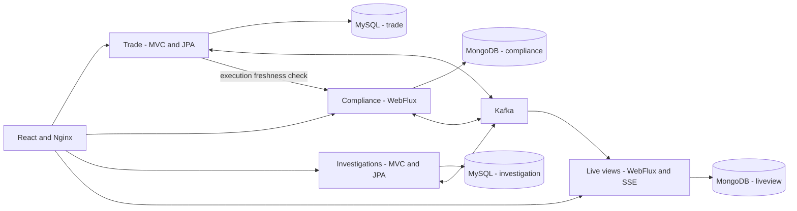

# TradeGuard

A Java and React portfolio application for synthetic pre-trade compliance checks, simulated trade execution, and post-trade investigations.

**Java 21 | Spring Boot 4.0.8 | React 19 | WebFlux | MySQL | MongoDB | Kafka**

## Download the application

Choose either option:

- **ZIP:** On this repository's GitHub page, select **Code > Download ZIP**, extract the archive, and open the extracted `tradeguard-main` folder. [Download main branch ZIP](https://github.com/vinodanu/tradeguard/archive/refs/heads/main.zip).
- **Git:** Clone the repository:

  ```sh
  git clone https://github.com/vinodanu/tradeguard.git
  cd tradeguard
  ```

All commands below run from the project folder containing `compose.yaml`, `README.md`, and `scripts/`. Do not run them from the `frontend` folder.

## Requirements

- Docker Desktop with its **Linux engine running**, or Docker Engine with Docker Compose on Linux.
- Docker Compose **2.24.4 or newer**. Docker Desktop includes Compose.
- Python **3.10 or newer**, with `pip` and `venv` available.
- Approximately **8 GB available to Docker**, disk space for downloaded images, and an internet connection for the first build.

You do **not** need to install Java, Maven, Node, MySQL, MongoDB, or Kafka to run the Docker version. The containers install/build those components. An AWS account is not required for local startup.

Check Docker before starting:

```sh
docker version
docker compose version
```

`docker version` should show both **Client** and **Server**. If the Server is unavailable, open Docker Desktop and wait for its Linux engine to start.

## Start on Windows (PowerShell)

Open PowerShell in the downloaded/cloned project folder:

```powershell
# For ZIP downloads, first navigate to the extracted folder:
# cd "$HOME\Downloads\tradeguard-main"

py -3 -m venv .venv
& .\.venv\Scripts\python.exe -m pip install -r requirements-bootstrap.txt
& .\.venv\Scripts\python.exe scripts/bootstrap.py

docker compose up --build -d --wait --wait-timeout 600
```

If `py` is unavailable but Python is installed, replace `py -3 -m venv .venv` with `python -m venv .venv`. If both commands are unavailable, install Python first and reopen PowerShell.

The bootstrap step checks Linux script line endings and generates local passwords and JWT signing keys. It preserves existing credentials on subsequent runs.

## Start on macOS or Linux

```sh
python3 -m venv .venv
.venv/bin/python -m pip install -r requirements-bootstrap.txt
.venv/bin/python scripts/bootstrap.py

docker compose up --build -d --wait --wait-timeout 600
```

The first run downloads images and dependencies, so it can take several minutes or longer on a slow connection. Later builds reuse cached layers. The 600-second wait applies to service startup; image downloads and builds can take longer.

## Open the application and sign in

Open **[http://localhost:8080](http://localhost:8080)**.

All seeded accounts use the generated password in the project's `.env` file. Look for:

```text
DEMO_PASSWORD=the-generated-password
```

Enter **only the value after `=`**, without `DEMO_PASSWORD=` or quotes. Keep `.env` private; it also contains local database credentials.

On Windows, open it with:

```powershell
notepad .env
```

| Account | Role | Use |
|---|---|---|
| `trader` | Trader | Submit and execute orders for Portfolio A |
| `trader2` | Trader | Submit and execute orders for Portfolio B |
| `reviewer` | Reviewer | Assign and resolve investigations |
| `admin` | Administrator | Publish rules, import trades, and run recovery tools |
| `viewer` | Viewer | Inspect the dashboard without mutation privileges |

Tokens last 15 minutes. Sign in again when a session expires. Changing `.env` does not automatically change passwords already stored in MySQL.

## Confirm the containers started

```powershell
docker compose ps -a
```

Expected state:

- `trade-service`, `compliance-service`, `investigation-service`, `live-view-service`, `mysql`, `mongo`, and `kafka`: **running and healthy**.
- `web`: **running**. This container does not currently have a healthcheck.
- `mysql`, `mongo`, and `kafka` remain running. Only `mongo-init` and `kafka-init` should show **Exited (0)**; their one-time setup has completed.

The default profile exposes only the frontend on `127.0.0.1:8080`. Database and broker ports are private to the Compose network.

## Try a complete demo

1. Sign in as **trader** and create `ACME`, quantity `10`, price `100`. It should become `READY`.
2. Create `FUND_X`, quantity `10`, price `100`. Its restricted `BANNED` underlying instrument should produce `BLOCKED`. Open the decision to inspect the relationship path.
3. Create `ACME`, quantity `1001`, price `100`. The initial $100,000 threshold should require review.
4. Sign in as **reviewer**, assign the case to yourself, and approve with an explanation. The order becomes ready.
5. As **admin**, publish a ruleset restricting `ACME`. An execution attempt now triggers fresh evaluation; the old approval no longer applies.
6. As **admin**, use Demo operations to import the sample historical CSV. A restricted execution opens a post-trade investigation.

All instruments, trades, and rules are synthetic. There is no live brokerage connection or real order execution.

## Stop and restart

Stop containers while preserving data:

```sh
docker compose down
```

Start again using the existing images and data:

```sh
docker compose up -d --wait --wait-timeout 600
```

After downloading code updates, rebuild:

```sh
docker compose up --build -d --wait --wait-timeout 600
```

`docker compose down -v` deletes the demo's database and broker volumes. Use it only when you intentionally want to reset the local data.

## Troubleshooting

### Docker connection denied or engine unavailable

Run commands in your normal terminal with Docker Desktop open and its Linux engine running. On Linux, use an account permitted to access the Docker daemon.

### Image download fails with `unexpected EOF`

This can be an interrupted download. Retry `docker compose up --build -d --wait --wait-timeout 600`; completed layers are reused.

### A container fails to start

```sh
docker compose ps -a
docker compose logs --tail=100 mysql kafka-init mongo-init trade-service compliance-service investigation-service live-view-service web
```

For a Windows checkout with bad shell line endings or interrupted initial database setup:

```powershell
powershell -NoProfile -ExecutionPolicy Bypass -File .\scripts\repair-startup.ps1
```

The repair preserves volumes, starts infrastructure, reruns idempotent MySQL application-user/database setup, and rebuilds service entrypoints. `.gitattributes` keeps Linux scripts in LF format, and bootstrap/CI check them before use.

### Login returns 401

Confirm the selected username and the current `DEMO_PASSWORD` value. If running images from an older version, update the frontend:

```sh
docker compose up -d --build --no-deps web
```

Hard-refresh the browser with **Ctrl+Shift+R** on Windows/Linux or **Command+Shift+R** on macOS. Current code omits bearer headers during public login. Do not paste `.env` or access tokens into issues.

### Port 8080 is already in use

Stop the conflicting program or change the `web` port mapping in `compose.yaml`, for example to `127.0.0.1:8081:80`, then open `http://localhost:8081`.

## Architecture



Four independently packaged services own separate databases and credentials. Decisions retain input/configuration snapshots and relationship paths. Transactional outboxes and durable inboxes implement at-least-once delivery with idempotent business effects. JWTs use RSA signatures and backend role/portfolio checks.

SQL aggregates use validated JSON payloads, relational IDs, optimistic versions, and selected indexes; this is a portfolio implementation, not a normalized financial ledger. Projection rebuild coordination assumes one Live View instance. Default limits are 500 orders and 1000 executions.

| Folder | Contents |
|---|---|
| `trade-service/` | Orders, executions, demo login, and MySQL persistence |
| `compliance-service/` | Rule evaluation, enrichment, and MongoDB snapshots |
| `investigation-service/` | Cases, reviewer actions, and audit history |
| `live-view-service/` | Dashboard projections, SSE, and recovery tools |
| `common*/` | Shared contracts, security, and persistence infrastructure |
| `frontend/` | React/TypeScript UI and Nginx configuration |
| `scripts/` | Bootstrap, startup repair, acceptance tests, backup, and benchmarks |
| `contracts/` | OpenAPI, event JSON Schema, and Pact verification |
| `infra/aws/` | Gated Terraform demonstration infrastructure |

More documentation: [architecture decisions](docs/ARCHITECTURE.md), [API examples](docs/API.md), [OpenAPI](contracts/openapi.json), [operations](docs/OPERATIONS.md), [AWS](docs/AWS.md), and [demo guide](docs/DEMO.md).

## Development and tests

For development outside Docker, install Java 21, Maven 3.9+, and Node 24. Database integration tests require Docker.

```sh
mvn -B -ntp verify
mvn -B -ntp -Pintegration verify
cd frontend
npm ci
npm run build
npm test
npx playwright install chromium
npm run e2e
cd ../contracts
npm ci
npm test
cd ..
```

Use your Python virtual environment to run `scripts/test_client.py`. Against the running local stack, run `scripts/acceptance.py --recovery`. The recovery option briefly stops/restarts local services. See [operations](docs/OPERATIONS.md) for coordinated backup/restore and the local-only performance profile.

Backend tests cover rules, access, decimal/CSV validation, stale versions, and failure handling. Testcontainers checks MySQL/MongoDB transactions and Kafka redelivery. Browser tests use deterministic API fixtures, not live persistence. Pact verifies a specific event against Java provider serialization. On Windows, Pact's native library requires the Microsoft Visual C++ runtime.

See [validation status](docs/VALIDATION.md) for exactly what has been checked. No throughput result is claimed until a benchmark has run.

## AWS hosting

Local startup never creates AWS resources. The AWS profile is an optional, temporary demonstration using one EC2 instance, an encrypted volume, local MySQL/Kafka, Atlas Free, and HTTPS.

Before provisioning, verify actual account eligibility, credits, expiry dates, memory sizing, and estimated costs with a 20% credit reserve. Terraform defaults to refusing deployment until these checks are attested. Stopped instances can retain storage charges; full teardown is required. See [AWS instructions](docs/AWS.md).

## License

No open-source license has been selected for this repository yet.
